# ComfyUI-NewBie-LLM-Formatter

[](https://comfy.org/)
[](https://opensource.org/licenses/MIT)
[](https://huggingface.co/NewBie-AI/NewBie-image-Exp0.1)


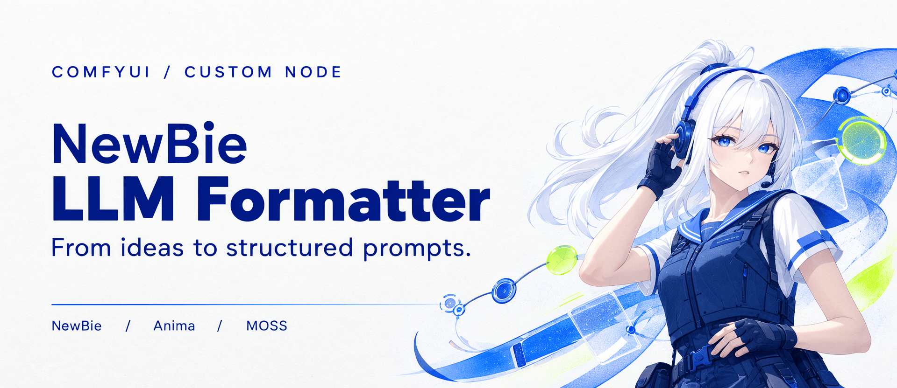

利用大语言模型 API，将自然语言、Danbooru 标签或图片转化为适用于 **NewBie、Anima 和 MOSS** 的提示词。NewBie 输出结构化 XML，Anima 输出标签与英文自然语言，MOSS 支持普通描述（caption）和空间布局（Layout）。

在节点的 `mode` 中选择目标模型即可使用。三个模式均支持图片反推、Agent 标签搜索和增量修订；生成的提示词从 `xml_out` 输出，中文说明与翻译从 `text_out` 输出。

<a id="moss-update"></a>

<details open>
<summary><h2 style="display:inline">重要更新：MOSS 可视化布局（v1.4.1）</h2></summary>

MOSS 模式支持普通描述（caption）与空间布局（Layout）。本次新增可视化编辑节点：在画布上安排人物、物体和文字区域，由 LLM 补全描述并编译成 MOSS 提示词。

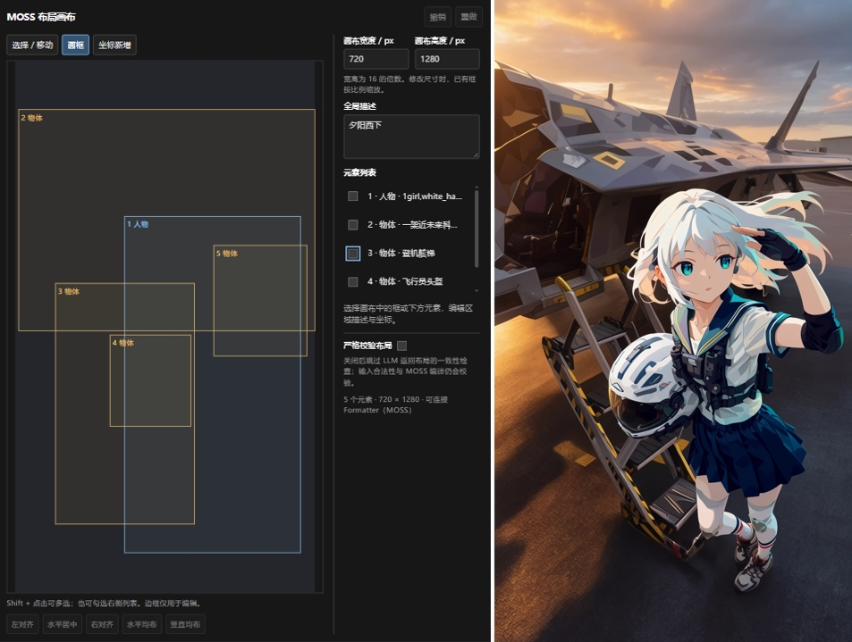

### MOSS 可视化布局编辑

在 `NewBie LLM Formatter` 分类中添加 **MOSS Layout Editor** 节点，即可为人物、物体和文字安排位置，并生成对应的 MOSS Layout 提示词。画板支持手工编辑，也可以展开内置的 **Agent 布局助手**，通过连续对话创建和修订布局。

#### 手动画框与编辑

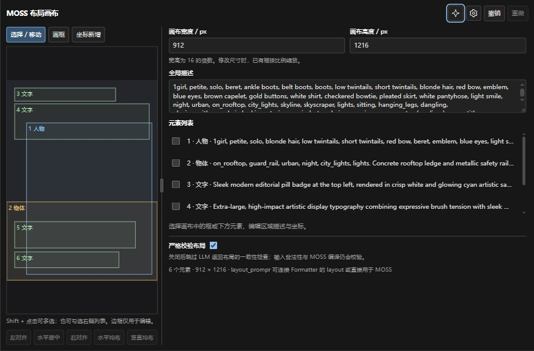

左侧是布局画布，右侧是画布尺寸、全局描述和元素属性。拖动两栏之间的分隔条可以调整栏宽；拖动节点边角可以扩大编辑空间，不改变实际图像尺寸或框的坐标。

1. 设置画布宽高，均需为 **16 的正整数倍**，并填写全局描述。
2. 点击 **画框**，在画布上拖拽创建矩形；也可通过 **坐标新增** 精确输入位置。
3. 选中画布中的框或元素列表中的条目，编辑类型、描述和坐标。元素分为人物、物体和文字；文字元素还需填写实际要显示的文字，包括标点与换行。
4. 使用 **选择 / 移动** 调整位置，拖动边框手柄调整大小。支持 Shift + 点击或列表勾选多选，以及对齐、等间距均布、撤销和重做。

修改画布的实际像素宽高时，已有框会按比例缩放。水平、竖直均布需要至少选中三个框，并有足够空间。

#### 使用 Agent 连续创作

点击右上角的 **四芒星按钮** 展开 Agent 面板，再次点击可收起。展开面板不会自动运行 Agent。

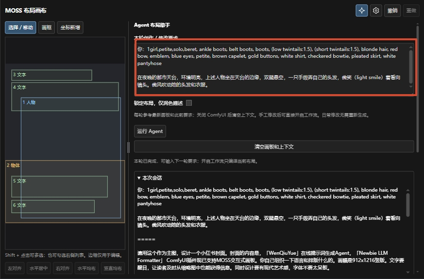

在 **本轮创作 / 修改要求** 中输入需求，点击 **运行 Agent**。它独立于 ComfyUI 的工作流执行按钮，可用于从空画板创建布局，也可继续修改已有作品，例如：

- “生成一张夜景杂志封面，人物坐在屋顶，标题放在上方。”
- “把标题放大一点，人物向右移动，其他元素保持不变。”
- “仅润色提示词，不调整画框。”

每轮都会参考**当前画板和此前已完成的对话**。用户手工移动框、修改描述后，下一轮以修改后的画板为准。即使输入与上一轮相同，点击运行也会执行新一轮。

需要保留构图时，可勾选 **锁定布局，仅润色描述**：锁定画布尺寸、元素数量与顺序、类型、框的位置和可见文字，只调整描述。明确要求“仅润色”“不调整画框”等也会启用对应约束；使用开关可以更明确地指定修改范围。

运行期间编辑锁定，画布区域显示模型实际返回的思考内容和工具调用进度，可点击 **取消任务**。成功后整体回填布局，可一次撤销，也可继续手工修订；本轮输入清空，已完成记录可在 **本次会话** 中查看。失败或取消会保留原画板和本轮输入。

**清空画板和上下文** 用于开始新作品：确认后清除画板内容、输入、提示词预览和对话，保留画布尺寸与模型设置。此操作不可撤销；运行中的任务需先取消并等待结束。对话上下文仅保存在 ComfyUI 进程内存中，关闭或重启后清空；画板本身仍随工作流保存。

#### Agent 设置

点击右上角的 **齿轮按钮**，选择模型、努力等级，并设置思考和网页搜索。

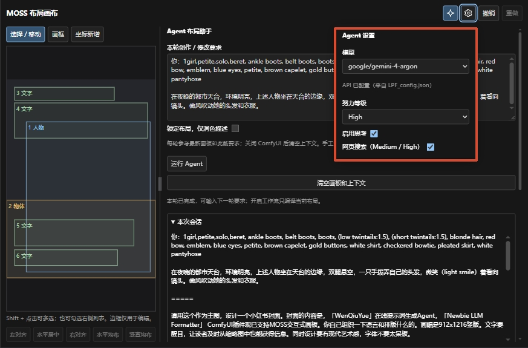

- **模型与 API**：模型列表及 API 凭据来自 `LPF_config.json`，请先完成配置。
- **努力等级**：支持 Close / Low / Medium / High，按需选择生成与搜索强度。
- **启用思考**：请求模型返回思考内容；能否显示取决于模型及 API 的支持情况。
- **网页搜索**：在 Medium / High 下可用，需要配置 Tavily API Key。

#### 连接工作流与输出

手工编辑完成后，可以直接开启工作流。**Layout 编辑节点只编译当前画板，不调用 LLM，也无需先运行 Agent。** 有效的编译结果会复用，手工修订后会重新编译。

| 输出 | 用途 |
| --- | --- |
| `layout_prompr`（STRING） | 已编译的 MOSS Layout 提示词，可直接用于 MOSS，或连接 Formatter 的 `layout` 输入继续加工。 |
| `width` / `height`（INT） | 连接生成工作流的图像尺寸输入，确保与布局画布一致。 |

如需继续使用 Formatter，将其 `mode` 设为 **MOSS**，在 `user_text` 中补充画风等要求，并使用 Formatter 的 `xml_out` 作为最终正向提示词。后接 Formatter 时，它仍按自己的设置调用 LLM；节点内部的提示词预览和中文说明不单独输出为端口。

默认开启的 **严格校验布局** 用于约束后接 Formatter 时的布局一致性；它与 Agent 面板中控制本轮修改范围的“锁定布局，仅润色描述”分别设置。成品 Layout 字符串本身不携带画布宽高，请同时使用对应的 `width`、`height`。bbox 是构图约束，实际生成效果取决于 MOSS 模型。

可导入 [MOSS Layout 示例工作流](<MOSS Layout示例工作流.json>) 查看连接方式。安装或更新后，需重启 ComfyUI 并刷新页面，以加载节点后端与前端界面。

</details>

---

本插件的核心特性有：

- **Agent 智能搜索**：生成提示词时自动搜索 Danbooru 标签库，验证和补充标签，减少标签幻觉。四级努力控制（Close / Low / Medium / High），在速度与精度间灵活选择。
- **三种模型支持**：NewBie 生成结构化 XML，Anima 生成标签与英文自然语言，MOSS 生成 caption 或 Layout，可在节点内切换。
- **MOSS 可视化布局**：在自适应画布上绘制矩形框，为人物、物体和文字指定位置与描述，支持坐标输入、多选对齐与均布，并生成对应的 Layout 提示词。
- **智能提示词转化**：支持将简单的自然语言、Danbooru 标签串，完美转化为目标模型所需的提示词格式。
- **多模态视觉反推**：支持传入图片，利用多模态大模型直接反推生成高精度提示词。
- **高鲁棒性与自动修复**：内置 XML 语法解析与自动修复机制，外加 API 网络异常/格式异常自动重试逻辑（最高 3 次），确保工作流不中断。
- **画风预设与管理**：内置数十种高质量艺术家/画风预设，支持按 NewBie / Anima / MOSS 区分、一键注入，并可从风格注入节点直接保存当前组合。
- **可选联网搜索**：在 Medium / High 下启用 Tavily 搜索，按需查找角色、作品、服装等参考资料，辅助生成提示词。
- **深度思考与破限支持**：适配主流 API 的"深度思考"模式（Deepseek、OpenRouter、Gemini、Anthropic、Kimi、MIMO、Vercel 等），内置 NSFW 提示词破限框架。

- 项目 GitHub 地址：https://github.com/SuzumiyaAkizuki/ComfyUI-NewBie-LLM-Formatter
- 项目 ComfyUI Registry 地址：https://registry.comfy.org/zh/nodes/NewBie-LLM-Formatter

---

## 目录

- [MOSS 可视化布局（v1.4.1）](#moss-update)
- [效果展示](#效果展示)
- [安装和使用方法](#安装和使用方法)
- [Agent 模式](#agent-模式)
- [配置文件说明](#配置文件说明)
- [节点说明](#节点说明)
- [依赖](#依赖)
- [参考工作流](#参考工作流)
- [更新说明](#更新说明)
- [其他](#其他)

---

## 效果展示

|                            Prompt                            |            使用模型             |                             结果                             |
| :----------------------------------------------------------: | :-----------------------------: | :----------------------------------------------------------: |
|                  天海春香和菊地真在一起演出                  | deepseek-v4-pro/anima-base-1.0  |  |
| 为我生成一个不良少女、辣妹的完整图像。要求如下：1. 必须含有皮项圈、露指手套、腰间系着夹克、高马尾这四个元素 2. 画面必须完整，有动作、背景等。动作要有动感。3. 画面以人物为主体，头胸部特写。其它特征自由发挥。 | deepseek-v4-pro/anima-base-1.0  |  |
|                        （见下文[1]）                         |   deepseek-v4-pro/Newbie 0.1    |  |
| 《向山进发》中的雪村葵和《摇曳露营》中的志摩凛一起在富士山脚下露营。 | gemini-3.5-flash/anima-base-1.0 |  |


```
[1]:1girl,white_hair,blue_eyes,medium_hair,high_ponytail,sidelocks,headset<br/>parted_lips<br/>small_breasts,white_serafuku,white_shirt,deep_blue_sailor_collar,short_sleeves,shirt_tucked_in,elbow_pads,fingerless_gloves,toned,tactical_school_uniform,utility_vest,red_neckerchief,high-waist_belt,nylon_belt,unit_patch,<br/>white_skirt,short_skirt,knee_pads<br/>在一片废弃的工厂里，上述人物分开双腿站立，她一条胳膊竖直向下，另一条胳膊抱着这条竖直向下的胳膊(hand on own arm)。她表情决绝、坚定。衣服上有血迹且残破、磨损，体现出战斗后的战损感。cowboy_shot.
```


## 安装和使用方法

### 方法一：命令行安装（推荐）

```bash
comfy node install NewBie-LLM-Formatter
```

### 方法二：手动安装

1. 点击 GitHub 页面中绿色按钮 `<> Code`，点击 **Download ZIP**，下载压缩包。

   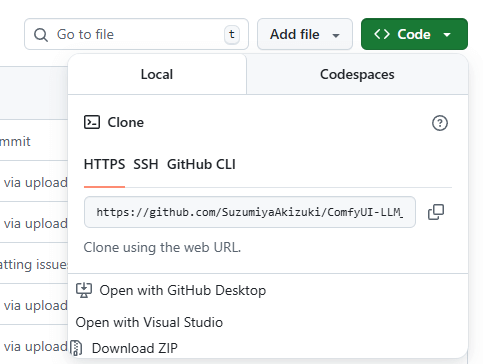

   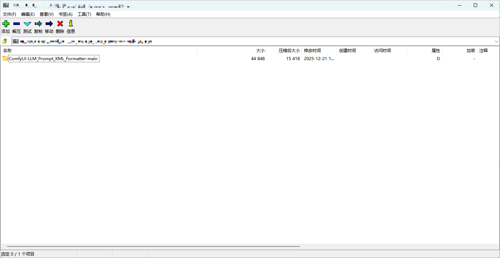

2. 将解压后的文件夹放置在 `...\ComfyUI\custom_nodes\` 目录下。

   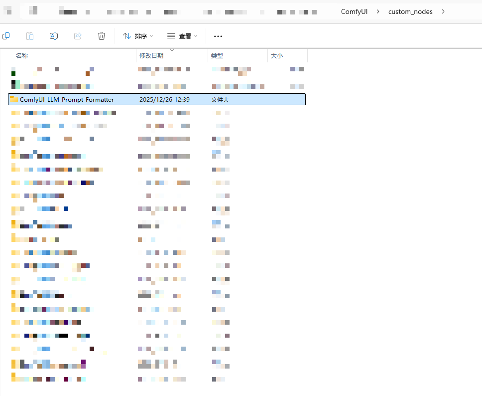

3. 进入文件夹，将 `LPF_config.json.example` **复制一份**并命名为 `LPF_config.json`。已有配置的用户请保留原文件，按需补充新字段，避免覆盖 API Key 和自定义风格。

   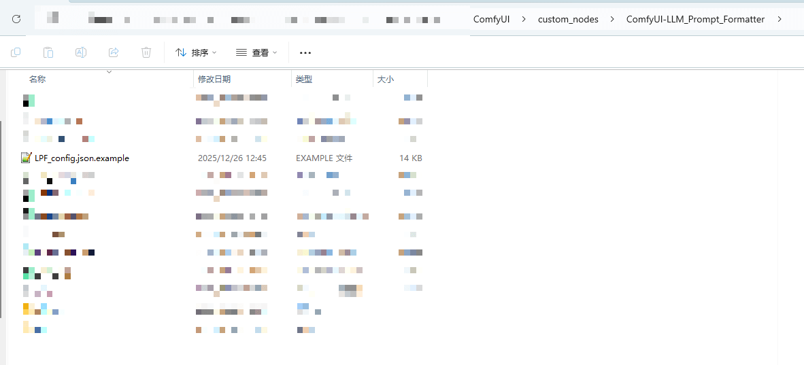

   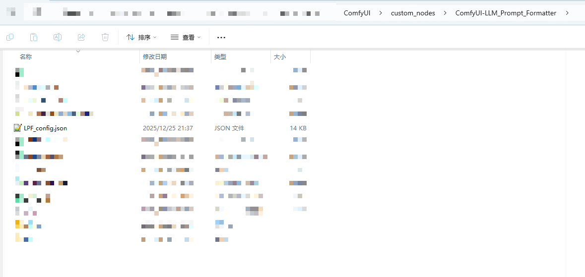

4. 使用记事本或文本编辑器打开 `LPF_config.json`，按照下方[配置文件说明](#配置文件说明)填写对应字段。

   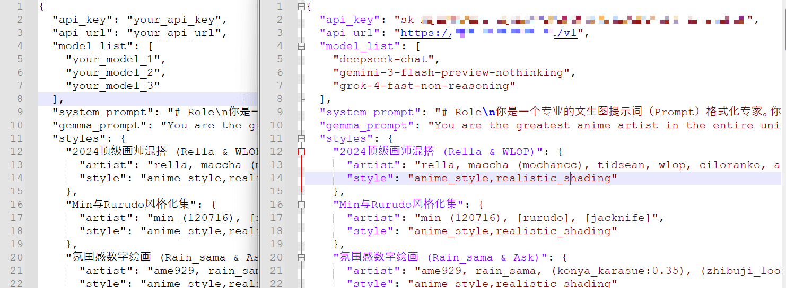

5. 重启 ComfyUI，即可使用。

---

## Agent 模式

传统模式下LLM 只能凭训练记忆生成标签，容易产生幻觉（编造不存在的标签）或遗漏关键属性。**Agent 模式**让 LLM 在生成提示词的过程中调用[DanbooruSearchOnline](https://huggingface.co/spaces/SAkizuki/DanbooruSearch)的MCP服务，**实时搜索 Danbooru 标签库**，像人类一样查找、验证、补充标签，辅助生成符合目标模型格式的提示词。

### 具体行为

- **自动搜索标签**：根据你的描述，自动在 Danbooru 标签库中搜索匹配的发型、服装、表情、场景等标签。
- **关联扩展**：从搜索结果出发，沿标签共现图谱自动发现你可能没想到的补充标签。
- **智能组装**：将搜索到的标签按规范格式整理输出（NewBie 为 XML，Anima 为标签与英文自然语言，MOSS 为 caption 或 Layout）。
- **尊重已有标签**：如果你已经在输入中提供了标签，Agent 会直接信任并使用，不会重复搜索。

### 使用方法

在 LLM Xml Prompt Formatter 节点中找到 `agent_effort` 下拉框，选择努力等级：

| 等级 | 说明 | 适用场景 |
|------|------|---------|
| **Close** | 关闭标签搜索，直接生成提示词（MOSS 仍需格式与编译工具） | 已有完整标签、追求速度 |
| **Low** | 流水线模式：批量搜索后直接组装提示词（MOSS 另需编译） | 追求最快速度，场景不复杂 |
| **Medium** | Agent 循环模式：多轮迭代搜索，最多 8 轮 | 日常使用，速度与质量平衡 |
| **High** | Agent 循环模式：宽召回 + 深探索，最多 10 轮 | 复杂场景、多人物、追求极致精度 |

> **建议**：日常使用选 **Medium**；输入已经是完整的标签串时选 **Close**（或 **Low**，按需搜索后组装）；复杂场景选 **High**。

### 效率提示

- 如果你已经有一组标签，直接在输入框粘贴（逗号分隔），Agent 会优先使用已有标签，减少重复搜索。
- 混合输入（标签 + 自然语言描述）会只搜索自然语言部分涉及的维度，不会浪费轮次。
- 控制台会显示 `[Agent]` 前缀的详细日志，可以观察每轮的搜索内容和 Token 消耗；开启 `thinking` 后，还会实时流式显示模型返回的思考内容。

---

## 配置文件说明

插件使用 `LPF_config.json` 保存 API 设置、各模型的补充要求、示例对话和风格预设。首次使用时，将 `LPF_config.json.example` 复制为 `LPF_config.json`，填写自己的 API 信息。通过命令行安装的用户也需要完成此步骤。

升级时保留自己的配置，参考新版示例补充所需字段即可。修改后建议重启 ComfyUI；新增风格预设后刷新页面以更新下拉列表。请勿分享含有密钥的配置文件。

| 字段 | 类型 | 说明 |
|------|------|------|
| `api_key` | `string` | LLM 的 API Key。建议在此填写，避免密钥随工作流或原图被分享。 |
| `api_url` | `string` | 兼容 OpenAI 的 API 地址，填写到 `/v1` 等服务要求的路径，例如 `https://openrouter.ai/api/v1`。 |
| `tavily_api_key` | `string` | 可选的 Tavily 搜索密钥。填写后还需在节点打开 `enable_web_search` 并选择 Medium / High；留空不影响标签搜索。 |
| `model_list` | `array` | LLM 模型名称列表，显示在节点的模型下拉框中；与 `mode` 所选的图像模型不同。 |
| `gemini_jailbreaker` | `string` | 非 Gemini 官方 API 中转使用的增强提示词；通常无需修改。 |
| `gemma_prompt` | `string` | NewBie 输出前的固定引导词，通常无需修改；Anima 和 MOSS 不使用。 |
| `fewshot_user` / `fewshot_assistant` | `string` | NewBie 的示例用户输入与示例回复，两项同时填写时生效。 |
| `fewshot_user_anima` / `fewshot_assistant_anima` | `string` | Anima 的示例用户输入与示例回复，两项同时填写时生效。 |
| `fewshot_user_moss` / `fewshot_assistant_moss` | `string` | MOSS 的示例用户输入与示例回复，两项同时填写时生效。 |
| `artists_anima` | `string` | Anima 参考画师列表。可参考[视频说明](https://www.bilibili.com/video/BV1Q1w1zKEwk)或[资料链接](https://drive.google.com/file/d/1CtcODfWbDl8KThORS0GHZfcWKCCMUUmD/view)。 |
| `system_prompt_extra` | `string` | NewBie 的个人补充要求，如构图、光照或描述偏好；各努力等级均生效。 |
| `system_prompt_extra_anima` | `string` | Anima 的个人补充要求；各努力等级均生效。 |
| `system_prompt_extra_moss` | `string` | MOSS 的个人补充要求；各努力等级均生效，不应覆盖模型必需的格式规则。 |
| `styles` | `object` | 风格预设集合。每个预设包含 `mode`、`artist`、`style`，可直接编辑或用 Style Preset Saver 保存。`mode` 可选 NewBie、Anima、MOSS、Both（通用）。 |

### 补充要求与旧配置迁移

插件已内置三种模型的提示词格式，日常使用无需自行填写整份系统提示词。将个人偏好写入对应的 `system_prompt_extra*` 字段即可；留空时使用默认规则。

旧配置中的 `system_prompt`、`system_prompt_anima`、`system_prompt_moss` 已不再生效。升级时只需把其中自己添加的偏好移入对应的补充字段，无需复制整份旧格式规范。

### 示例对话（Few-shot）

Few-shot 用一组输入与回复示例帮助 LLM 理解期望的表达方式。三种模式各自使用对应字段；不需要时可留空。

示例回复建议写成含 `xml_out` 和 `text_out` 两个字符串的 JSON：前者放目标模型的完整提示词，后者放中文说明与翻译。由于配置字段本身是字符串，内部引号和换行需要转义。例如：

```json
{
  "fewshot_user_moss": "一只坐在窗边的白猫，柔和水彩风格",
  "fewshot_assistant_moss": "{\"xml_out\":\"A white cat sits beside a window in soft watercolor, lit by gentle daylight.\",\"text_out\":\"白猫坐在窗边，以柔和水彩表现，温柔的日光照亮主体。\"}"
}
```

已有的 NewBie XML 示例、Anima / MOSS 的 `## Prompt` 与 `## 中文解释` 示例仍可读取。节点会自动分离提示词与说明，无需在工作流中手动解析 JSON。

### 风格预设

`styles` 位于示例配置末尾，便于集中管理。MOSS 预设示例：

```json
{
  "水彩手绘": {
    "mode": "MOSS",
    "artist": "",
    "style": "watercolor, soft pigment washes, textured paper"
  }
}
```

`mode: "MOSS"` 的预设仅在 MOSS 模式显示；`Both` 表示通用预设。示例配置已提供多组 MOSS 风格，可按需复制到自己的配置中。

### API 配置优先级

配置文件中的值 **优先于** 节点 UI 中填写的值。具体逻辑如下：

1. 程序首先读取 `LPF_config.json` 中的 `api_key` 和 `api_url`；
2. 若配置文件中存在有效值，则使用配置文件的值，**节点 UI 中的输入不会生效**；
3. 若配置文件中无有效值，则回退使用节点 UI 中的输入。

> ⚠️ **安全提示**：在节点 UI 中填写的 API Key 会被保存在工作流文件中，**分享工作流原图即导致 API Key 泄露**。强烈建议始终使用配置文件进行配置。

---

## 节点说明

ComfyUI-NewBie-LLM-Formatter 提供四个节点：

### 1. LLM Xml Prompt Formatter

**功能：** 调用 LLM API，将用户输入的自然语言或标签集格式化为提示词，根据所选模式输出 NewBie XML、Anima 提示词或 MOSS caption / Layout。

**输入参数：**

| 参数 | 类型 | 说明 |
|------|------|------|
| `image` | IMAGE（可选） | 输入图片，传输给多模态 LLM 进行提示词反推。注意：这是让 LLM 反推提示词，而非图生图。 |
| `layout` | MOSS_LAYOUT（可选） | 连接 MOSS Layout Editor 的 `layout` 输出，仅 MOSS 模式可用。按画布布局生成提示词，`user_text` 可补充画风等要求。 |
| `api_key` | STRING | API Key。若配置文件中已有有效值，此处输入不生效。 |
| `api_url` | STRING | API 主机地址。若配置文件中已有有效值，此处输入不生效。 |
| `model_name` | STRING/下拉框 | 模型名称。若配置文件中的 `model_list` 有效，显示为下拉框；否则显示为文本输入框。 |
| `mode` | 下拉框 | **NewBie**（默认）、**Anima** 或 **MOSS**。决定目标模型的提示词格式。 |
| `thinking` | BOOLEAN | 深度思考模式开关。普通模式和 Agent 模式均生效。开启后可在控制台查看模型返回的思考内容；这些内容不会混入提示词输出。思考模式通常更慢且消耗更多 Token。 |
| `agent_effort` | 下拉框 | Agent 努力等级。`Close`（默认）= 关闭标签搜索，直接生成提示词（MOSS 仍需编译）；`Low` = 流水线模式（单轮批量搜索 + LLM 组装，不走 Agent 循环，最快）；`Medium` = Agent 循环模式（`full_scene` 预设，平衡召回质量与收敛速度，最多 8 轮）；`High` = Agent 循环模式（`full_scene` 预设 + 默认携带 wiki 释义，最多 10 轮，最深入）。 |
| `force_full_agent_run` | BOOLEAN | 强制本次 Agent 从头生成，不复用上一轮结果。通常保持关闭；当你觉得上一轮缓存影响了本次修改时，再临时打开。 |
| `enable_web_search` | BOOLEAN（可选） | Tavily 联网搜索开关，默认关闭，仅 `Medium` / `High` 生效。启用且已配置 `tavily_api_key` 时，Agent 可按需搜索角色、作品和服装等参考资料；关闭或缺少 Key 时不进行网页搜索。切换有效启用状态后会重新生成。 |
| `user_text` | STRING | 待转换的自然语言描述或标签集。 |

**输出参数：**

| 参数 | 说明 |
|------|------|
| `xml_out` | 可直接连接目标模型文本编码节点的提示词：NewBie 为 XML（含配置的引导前缀），Anima 为标签与英文自然语言，MOSS 为 caption 或 Layout。 |
| `text_out` | 中文说明与翻译。NewBie 包含 caption 翻译；Anima / MOSS 包含标签、构图等说明及英文自然语言翻译。MOSS Layout 还会说明画布尺寸。 |

**三种模式的行为差异：**

| 行为 | NewBie | Anima | MOSS |
|------|--------|-------|------|
| 提示词格式 | 结构化 XML | 标签与英文自然语言 | caption 或 Layout |
| 个人补充字段 | `system_prompt_extra` | `system_prompt_extra_anima` | `system_prompt_extra_moss` |
| `gemma_prompt` 前缀 | 使用 | 不使用 | 不使用 |
| XML 自动修复 | 启用 | 不适用 | 不适用 |
| Agent 标签搜索与增量修订 | 支持 | 支持 | 支持 |

**MOSS 使用提示：**

- 普通人物、照片和插画可使用 caption，支持 Danbooru 标签、自然语言或两者混合。需要文字定位、分镜或明确物体空间关系时，可在输入中要求 Layout。
- Layout 请明确生成尺寸；宽高必须是 16 的正整数倍，并在生成工作流中使用 `text_out` 提示的相同尺寸。
- 三种模式均只生成提示词，不直接生成图片。MOSS 在所有努力等级下都需要可用的远程格式与编译工具；所选 LLM API 也需支持工具调用。工具不可用时会报错，请检查服务连接。

**增量修订与复用：**

- **相同输入直接复用**：同一节点内，如果本次输入与上次完全一致，会直接返回上次结果，不再次调用 LLM。
- **仅标点/空白变化不重跑**：只调整逗号、空格、换行等不影响语义的内容时，也会直接复用。
- **小幅修改走增量修订**：当新旧提示词整体仍足够相似时，Agent 会把上一轮提示词、上一轮输出和本轮完整提示词一起交给模型，让模型对比后做最小化修订。当前相似度门槛为 `0.55`。
- **连续修改更稳**：Agent 会根据连续修改状态自动调整调度策略，避免长期局部修订带来的累积偏移。
- **需要彻底重做时可手动强制**：打开 `force_full_agent_run` 后，本次运行会忽略上一轮结果，从头生成。

以上复用与增量修订适用于 Formatter 的 `Low` / `Medium` / `High`。连接可视化 Layout 后，布局内容发生变化会重新生成；即使只调整 bbox，也会重新调用 LLM。`Close` 不使用上述 Agent 增量修订机制。Layout 编辑节点内部的独立 Agent 使用连续会话，不采用此相似度判定；编辑节点自身执行工作流仅编译当前画板，不调用 LLM。

**内置鲁棒性机制：**

- **自动重试**：遇到网络抖动或 API 报错时，最多自动重试 3 次。
- **XML 自动修复**（仅 NewBie 模式）：使用 `lxml` 库对 LLM 输出的 XML 进行格式校验；若检测到格式错误，会自动修复并在控制台打印差异对比。
- **异常恢复**：搜索或请求失败时尽量利用已有结果完成输出；无法完成时明确报错。MOSS 必须完成提示词编译，工具不可用时不会交付未完成的草稿。
- **Agent 死循环检测**：自动检测重复工具调用，超过 3 次强制退出循环。

**推荐模型（计价参考 [OpenRouter](https://openrouter.ai/)，均关闭思考模式）：**

| 模型名称 | 平均每次成本/美元 | NSFW 效果 | 输出质量 | 备注 |
|----------|-----------------|-----------|----------|------|
| `deepseek/deepseek-v3.2` | ~0.0008 | 均衡 | 均衡 | 综合性价比高 |
| `google/gemini-3-flash-preview` | ~0.0035 | 较好（G 向需技巧） | 最好 | NewBie 训练打标模型之一 |
| `x-ai/grok-4.1-fast` | ~0.0007 | 最好 | 较好 | NewBie 训练打标模型之一 |
| `xiaomi/mimo-v2-flash` | ~0.0004 | 较好 | 一般 | — |
| `cognitivecomputations/dolphin-mistral-24b-venice-edition:free` | 免费 | 官方宣称无审查 | 较差 | — |

> **思考模式说明：** 目前适配了 OpenRouter、DeepSeek、Google AI、Anthropic 官方、Kimi、小米 MIMO 和 Vercel AI Gateway 平台，普通模式和 Agent 模式均可使用。Agent 会优先流式展示平台实际返回的思考内容；若网关不支持流式，则自动回退为非流式并在请求完成后显示。部分模型只返回隐藏/加密推理或不返回可见思考文本，此时不会有可展示的思维链。其他平台请通过模型名称控制（如用 `deepseek-chat` 代替 `deepseek-reasoner`）。
>
> **免费额度提示：** 在 [DeepSeek 开放平台](https://platform.deepseek.com) 注册后可获赠 10 元免费额度，大约可使用 1000 次。

<details open>
<summary>NewBie 模式节点示例输入输出</summary>

**纯文本示例输入：**

```
A:(loli,(blonde hair:1.2),hair between eyes,short hair,ahoge,twintails,short tail,short_kimono,white socks,Frilled socks,converse,sash,red_sash,sidelocks,low twintails, fingerless gloves, haori,shorts under skirt,hairclip,leg belt)

B:(white hair,high ponytail,white serafuku,short sleeves,short skirt,shirt tucked in,knee pads,elbow pads,fingerless gloves,white legwear,kneehighs,high-top hiking sneakers,sidelocks,shorts under skirt,)

在一个科幻风格的指挥所中，画面左侧，A担任一场战役的指挥官。她戴着耳麦，正在指挥战役。指挥所里有全息显示的显示屏和地图。画面右侧，B穿着战术马甲、戴着头盔、拿着狙击步枪，正在执行作战任务。这两个场景的画面要有机地融合在一起，动漫风格、油画风格。
```

**`xml_out` 示例输出：**

```xml
You are an assistant designed to generate high-quality anime images with the highest degree of image-text alignment based on xml format textual prompts. <Prompt Start>


 <character_1>
 <n>A</n>
 <gender>1girl</gender>
 <appearance>loli, blonde_hair:1.2, hair_between_eyes, short_hair, ahoge, twintails, short_tail, sidelocks, low_twintails, hairclip</appearance>
 <clothing>short_kimono, white_socks, frilled_socks, converse, sash, red_sash, fingerless_gloves, haori, shorts_under_skirt, leg_belt</clothing>
 <expression>serious, focused</expression>
 <action>wearing_headset, commanding, pointing_at_hologram</action>
 <position>left_side</position>
 </character_1>

 <character_2>
 <n>B</n>
 <gender>1girl</gender>
 <appearance>white_hair, high_ponytail, sidelocks</appearance>
 <clothing>white_serafuku, short_sleeves, short_skirt, shirt_tucked_in, knee_pads, elbow_pads, fingerless_gloves, white_legwear, kneehighs, high-top_hiking_sneakers, shorts_under_skirt, tactical_vest, helmet</clothing>
 <expression>determined, focused</expression>
 <action>holding_sniper_rifle, aiming, in_combat_stance</action>
 <position>right_side</position>
 </character_2>

 <general_tags>
 <count>2girls</count>
 <style>oil painting, anime_style, realistic_shading</style>
 <background>sci-fi_command_center, holographic_displays, tactical_map, futuristic_technology</background>
 <atmosphere>tense, strategic</atmosphere>
 <quality>very_aesthetic, masterpiece, no_text</quality>
 <resolution>max_high_resolution</resolution>
 <artist>rella, maccha_(mochancc), tidsean, wlop, ciloranko, atdan, year_2024</artist>
 <objects>headset, sniper_rifle, tactical_gear, holograms</objects>
 </general_tags>

 <caption>In a futuristic sci-fi command center filled with holographic displays and tactical maps, two girls are depicted in different roles...</caption>
</img>
```

</details>

<details open>
<summary>Anima 模式节点示例输入输出</summary>

**示例输入：**

```
A：1girl,white_hair,blue_eyes, medium_hair, high_ponytail, small_breasts, sidelocks,serafuku,deep_blue_skirt, white_shirt, deep_blue_sailor_collar,  short_sleeves, short_skirt, shirt_tucked_in,elbow_pads, fingerless_gloves, shorts_under_skirt,toned, tactical_school_uniform,red_neckerchief,utility belt

上述人物的上半身特写(upper_body, close-up)，从正面视角注视着观众(straight-on, facing_viewer)。她骄傲地挺胸抬头(confident, proud,arched_back)、并在眼睛上方比出“V”字手势的姿势(v_over_eye)，另一只手叉腰(hand_on_own_hip)。她戴着耳麦和战术头盔(fast helmet, headset)，全身（胸部、大腿）戴着攀岩时用的全身安全带(full body harness,chest harness,leg loops,waist belt)。她的头发和衣服被风吹动(wind_lift)。背景是充满活力的抽象构图，由多彩的玻璃碎片、蓝色和紫色调以及图形元素组成，保持了酷炫且时尚的氛围。

要求人物是萌系画风，可爱一点。
```

**`xml_out` 示例输出：**

```
masterpiece, best quality, score_7, safe, @kantoku, @tiv, @mika pikazo, @anmi, 1girl, white hair, blue eyes, medium hair, high ponytail, small breasts, sidelocks, serafuku, white shirt, deep blue skirt, deep blue sailor collar, short sleeves, short skirt, shirt tucked in, red neckerchief, utility belt, shorts under skirt, elbow pads, fingerless gloves, toned, tactical school uniform, fast helmet, headset, full body harness, chest harness, leg loops, waist belt, upper body, close-up, straight-on, facing viewer, confident, proud, arched back, v over eye, hand on hip, wind lift, abstract background, glass shards, blue theme, purple theme, graphic background
An adorable girl with white hair and striking blue eyes poses confidently in her tactical sailor uniform, standing with an arched back and one hand on her hip while making a cute V sign over her eye. Her high ponytail and white shirt flutter in the wind, and she wears a FAST helmet, headset, and complex full-body climbing harness over her outfit. The background is a stylish abstract composition of vibrant blue and purple glass shards with modern graphic elements.
```

**`text_out` 示例输出：**

```
- 标签结构：质量锚点(masterpiece, best quality, score_7, safe) → 画师(@kantoku, @tiv, @mika pikazo, @anmi) → 主体(1girl) → 角色特征(white hair, blue eyes, ...) → 服装(serafuku, ...) → 装备(fast helmet, full body harness, ...) → 构图(upper body, close-up) → 姿势表情(confident, v over eye, hand on hip) → 背景(abstract background, glass shards)。
- 自然语言描述了角色的自信姿态、V 字手势、战术装备细节和抽象背景氛围，补充了标签无法精确表达的空间关系和画面张力。
- 翻译：一位白发蓝眸的可爱女孩穿着战术水手服，挺起胸膛一手叉腰，在眼前比出 V 字手势，骄傲地直视观众。高马尾和衬衫在风中飘动，佩戴战术头盔和全身攀爬安全带。背景是蓝紫色玻璃碎片组成的时尚抽象构图。
```

</details>

---

### 2. XML Style Injector

**功能：** 将画师和风格信息注入到提示词中，支持 NewBie（XML）、Anima（纯文本）和 MOSS（caption / Layout）三种模式。

**输入参数：**

| 参数 | 类型 | 说明 |
|------|------|------|
| `xml_input` | STRING | 待处理的提示词文本。NewBie 模式下应为含 `` 标签的 XML；Anima 模式下为纯文本；MOSS 模式下为 caption 或 Layout 提示词。 |
| `mode` | 下拉框 | **NewBie**、**Anima** 或 **MOSS**，需与 LLM Xml Prompt Formatter 节点的模式保持一致。 |
| `preset` | 下拉框 | 选择预设风格提示词集合，内容来自 `LPF_config.json` 的 `styles` 字段。新预设会显示 `[NewBie]`、`[Anima]`、`[MOSS]` 或 `[Both]` 前缀；旧工作流中的原名称仍然可用。 |
| `artist_add` | STRING（可选） | 额外的画师标签，将**拼接在预设画师列表之前**。 |
| `style_add` | STRING（可选） | 额外的风格标签，将**拼接在预设风格列表之前**。 |

**输出参数：**

| 参数 | 说明 |
|------|------|
| `xml_output` | 注入风格后的提示词。 |
| `style_save_metadata` | 保存专用输出，包含本次实际使用的模式、原始画师列表和风格文本，可直接连接到 Style Preset Saver。 |

`style_save_metadata` 不会改变图像提示词本身，只是方便把当前组合保存成新预设，格式类似：

```xml
<mode>NewBie</mode>
<artist>...</artist>
<style>...</style>
```

**NewBie 模式行为：**

查找 XML 中的 `<artist>` 和 `<style>` 标签并替换为选定预设的内容。若 XML 中不存在对应标签，节点会尝试在 `<general_tags>` 容器下创建。若对应字段为空，则不修改原标签内容。

**Anima 模式行为：**

不同模型对画师和风格词的响应可能不同，建议优先使用对应模式的预设。

Anima 模式下的画师和风格注入逻辑：

- **画师注入位置**：注入到第一行（质量词行）之后。若第二行已是独立的画师行（整行均为 `@xxx` 格式），则整行替换；否则先清除第一行中内嵌的 `@xxx` 标记，再在其后插入新画师行。
- **风格注入位置**：追加到整个提示词的最末尾。
- **空字段行为**：若 `artist_add` 和预设画师均为空，则不修改画师内容；若风格字段均为空，则不追加风格，保持原内容不变（与 NewBie 模式对齐）。

**Anima 模式画师格式：**

输入的画师字符串在注入前会经过以下清洗步骤：

1. 删除方括号、大括号、圆括号：`[ciloranko]` → `ciloranko`
2. 删除 `artist:` 前缀（大小写不敏感）：`artist:rella` → `rella`
3. 删除冒号权重（`:1.2`、`:0.93` 等），再删除所有剩余冒号
4. 删除独立的数字/小数（不紧邻字母或下划线的数字）：`wlop 1.1` → `wlop`；`year_2024` 中的 `2024` 紧邻下划线，保留
5. 将名称内部空格替换为下划线：`some artist` → `some_artist`
6. 为每个名称添加 `@` 前缀：`rella` → `@rella`

示例：`[ciloranko], maccha_(mochancc), (tidsean:1.2), wlop 1.1, year_2024`
→ `@ciloranko, @maccha_mochancc, @tidsean, @wlop, @year_2024`

**MOSS 模式行为：**

非空画师与风格分别以前置块注入，顺序为画师、风格，再空一行保留原提示词：

```text
<|artist|> 画师内容 <|/artist|>
<|style|> 风格内容 <|/style|>

原始 MOSS 提示词
```

为空的字段不生成对应块；两个字段均为空时原样输出。MOSS 不使用 Anima 的画师格式清洗规则。保存当前组合时，可将 `style_save_metadata` 连接到 Style Preset Saver。

配置文件内置数十个预设风格串，可在[此链接](https://docs.qq.com/sheet/DTUNCQW5TWFBMVGhY?tab=BB08J2)查看例图。

---

### 3. Style Preset Saver

**功能：** 从当前提示词或风格注入节点的保存输出中提取画师、风格和适用模式，并将其保存为新的风格预设到 `LPF_config.json` 中，方便后续在 XML Style Injector 中调用。

**输入参数：**

| 参数 | 类型 | 说明 |
|------|------|------|
| `text_input` | STRING | 输入包含 `<artist>`、`<style>` 和可选 `<mode>` 的文本，或含 `<|artist|>` / `<|style|>` 块的 MOSS 提示词；可直接连接风格注入节点的 `style_save_metadata` 输出。 |
| `preset_name` | STRING | 新预设的名称。若名称为空或与已有预设重名，节点将放弃保存。 |
| `save_trigger` | BOOLEAN | 保存开关。仅当显示 `Save as Styles` 时才会执行保存操作；显示 `Do Not Save` 时仅提取不保存。 |
| `mode` | 下拉框（可选） | 默认 `Auto`，根据输入模式信息或 MOSS 标记自动判断；也可手动指定 NewBie、Anima、MOSS 或 Both。 |

**输出参数：**

| 参数 | 说明 |
|------|------|
| `extracted_tags` | 从输入中提取到的风格标签预览。若输入包含模式信息，会显示为 `<mode>...</mode>\n<artist>...</artist>\n<style>...</style>`；无论是否保存均会输出。 |

> **注意：** 旧版只包含 `<artist>` / `<style>` 的保存输入仍然可用；新版从风格注入节点保存时会同时带上模式信息，便于在预设列表中区分 NewBie、Anima、MOSS 或通用风格。

---

### 4. MOSS Layout Editor

**功能：** 在可视化画布上编辑 MOSS 空间布局，输出供 Formatter 使用的结构化布局。详细操作见 [MOSS 可视化布局](#moss-update)。

| 编辑项 | 说明 |
|--------|------|
| 画布宽高 | 生成图像的像素尺寸，必须是 16 的正整数倍；修改时已有框按比例缩放。 |
| 全局描述 | 描述整体场景、氛围和构图。 |
| 元素类型与描述 | 支持人物、物体和文字；每个元素有独立描述与矩形 bbox。 |
| bbox 坐标 | 以画布左上角为原点，按像素输入左、上、右、下坐标；也可拖动与缩放框。 |
| 文字原文 | 文字元素需要填写实际显示的文字，保留标点与换行。 |
| 严格校验布局 | 默认开启，检查 LLM 返回的布局是否保留尺寸、元素、坐标与文字原文。 |

**输出参数：**

| 参数 | 类型 | 说明 |
|------|------|------|
| `layout` | MOSS_LAYOUT | 连接 Formatter 的可选 `layout` 输入，并将其 `mode` 设为 MOSS。 |
| `width` | INT | 连接生成工作流的图像宽度输入。 |
| `height` | INT | 连接生成工作流的图像高度输入。 |

节点采用左画布、右编辑面板的两栏布局，随节点大小调整显示空间。编辑内容随工作流保存；节点显示大小与生成图像尺寸相互独立。此节点只编辑布局，提示词生成由 Formatter 完成。

---

## 依赖

请参考项目中的 `requirements.txt`

---

## 参考工作流

项目提供以下示例：

- [NewBie 示例工作流](NewBie示例工作流.json)：NewBie 提示词生成与风格注入。
- [Anima 示例工作流](Anima示例工作流.json)：Anima 提示词生成与风格注入。
- [MOSS Layout 示例工作流](<MOSS Layout示例工作流.json>)：可视化布局编辑与 Formatter 接线。导入后请配置 API，并选择本地配置的模型；生成图像时，将提示词连接到 MOSS 文本编码节点，并使用相同的画布尺寸。

**加载方法：** 右键另存为 → 打开 ComfyUI → 按 <kbd>Ctrl</kbd>+<kbd>O</kbd> → 选择此文件。

---

## 更新说明

<details open>
<summary>展开/折叠更新历史</summary>

### 2026年10月25日 v1.4.2

> 优化 MOSS Layout 编辑与 Agent 创作体验。

- **画板内使用 Agent**：支持直接生成布局、连续提出修改要求，或锁定布局仅润色描述；生成后可继续手工调整。
- **输出更顺手**：手工修改后可直接运行工作流，输出当前布局提示词，无需再次运行 Agent。
- **交互更清晰**：支持调整左右栏宽，优化面板展开与运行动效，减少重复日志，补充运行进度和取消操作。
- **使用说明更直观**：新增三张界面截图，完善画板编辑、Agent 设置和工作流连接说明。

### 2026年10月22日 v1.4.1

- **新增 MOSS Layout Editor**：可在画布上绘制矩形 bbox 或输入坐标，为人物、物体和文字分别填写描述；布局通过 `layout` 接入 MOSS Formatter，支持全部 Agent 努力等级。
- **大画布与自适应编辑空间**：左侧画布、右侧元素描述和属性面板，随节点宽高伸缩，右侧独立滚动；调整节点大小不影响生成尺寸与框坐标。
- **布局编辑工具**：支持框的移动与缩放、多选、对齐、水平/竖直等间距均布及撤销/重做；修改画布尺寸时已有框按比例缩放，编辑内容随工作流保存。
- **布局一致性校验**：默认检查 LLM 是否保留画布尺寸、元素数量/顺序/类型、bbox 与文字原文；可关闭一致性检查，输入合法性与编译校验仍然生效。
- **补充示例与使用文档**：新增 MOSS Layout 示例工作流、布局与生成效果对照图，完善四个节点的说明，并将 Agent 使用指南移至独立章节。

### 2026年10月20日 v1.4.0

- **新增 MOSS 支持**：自然语言、标签和图片均可转换为 MOSS caption 或 Layout，支持 Agent 搜索与增量修订；Layout 会提示生成所需的画布尺寸。
- **MOSS 风格管理**：风格注入与保存节点支持 MOSS，预设列表按模式筛选；示例配置新增多组 MOSS 风格。
- **可选联网搜索**：配置 Tavily 密钥并在 Medium / High 中打开 `enable_web_search`，可按需查找角色、作品和服装等参考资料。
- **配置更简洁**：三种模型均内置提示词格式，个人偏好改用 `system_prompt_extra*`；补充 MOSS 示例对话字段，风格预设集中在配置末尾。旧 `system_prompt*` 字段请按配置说明迁移。
- **输出更清晰稳定**：提示词与中文说明分开输出，补充英文自然语言的完整翻译；改善 MOSS 完成提示词后的输出稳定性，减少说明文字混入提示词的情况。

### 2026年08月25日 v1.3.6

> 本次更新主要是BUG修复

- 修复了部分情况下思考信息重复的问题
- 修复了风格注入节点的拼写错误
- 修复了部分情况下Agent被注入意外提示词的问题

### 2026年08月06日 v1.3.5

> 让 Agent 的思考、搜索和异常恢复更稳定，同时改善 Anima 提示词的构图与多人表现。

- **Agent 深度思考可用**：`thinking` 开关现在同样作用于 Agent 模式；开启后可以在控制台实时查看模型返回的思考内容。
- **纯文本搜索启动更快**：Medium / High 模式会直接理解文本并规划搜索，减少额外等待和 Token 消耗；Low 模式和带图输入仍会保留完整的画面拆解流程。
- **Agent 搜索更顺畅**：优化了格式获取、首批搜索和关联探索之间的调度，减少不必要的等待、重复搜索和无效轮次。
- **已有标签识别更可靠**：标签与中文描述、角色名、括号或冒号混合输入时，也能更准确地识别用户已经给出的标签，避免重复检索和误改。
- **网络异常更容易恢复**：Agent 请求失败时会自动重试，并尽量根据已经取得的搜索结果完成输出；彻底失败时会明确报错并保存诊断信息，不再静默切换为普通模式。
- **Anima 示例配置更完善**：使用新版示例配置时，人物占比、背景层级、前景遮挡、主体曝光和多人特征归属更加稳定；同时补充了多组画师与风格预设，方便直接参考和调整。

### 2026年07月11日 v1.3.4

> 让 Agent 的运行过程更透明，画师理解和图片迭代更可靠，风格预设保存更顺手。

- **Agent 过程可视化**：节点内新增 Agent 运行面板，可以直接看到当前轮次、搜索方向、工具调用状态和关键结果摘要，复杂提示词生成不再只能看控制台日志。
- **画师理解更准确**：当你明确提到某位画师或画师 tag 时，Agent 会更有针对性地理解其常见风格参考；需要推荐画师时，也会更重视画面风格而不是只按主体标签匹配。
- **图片迭代更可靠**：带图反推后继续修改时，Agent 能更好地区分「同一张图的小改」和「换图后的重新生成」，减少误用上一轮结果的情况。
- **连续修改更稳**：优化了 Agent 调度逻辑，长时间连续微调提示词时更不容易积累偏差。
- **风格预设更清楚**：风格下拉列表会按 NewBie / Anima / 通用类型展示更合适的预设，旧工作流中的原预设名称仍然兼容。
- **风格保存更安心**：Style Preset Saver 运行后会自动回到 `Do Not Save`，减少下一次工作流运行时误重复保存的情况。

### 2026年06月26日 v1.3.3

> 让 Agent 的迭代修改更可控，风格预设的保存和选择更清晰，旧工作流继续可用。

- **改提示词更稳**：在上一轮结果基础上继续修改时，Agent 会更认真地对比「修改前」和「修改后」的完整描述，减少只改一半、误改无关标签、或把新增要求放错位置的情况。
- **复杂小改动也能续写**：对相似度很高但同时改了多个细节的提示词，插件会尽量继续复用上一轮结果，而不是轻易从头重跑；中文书名号、括号等内容也更不容易被截断。
- **可一键强制重跑 Agent**：新增 `force_full_agent_run` 开关。需要彻底摆脱上一轮缓存影响时，可以临时打开它，让本次生成从头开始。
- **减少空响应中断**：部分 API 网关返回内容位置不一致时，Agent 现在更容易正确读到结果，复杂改写也更少因为空响应而失败。
- **风格预设更容易区分**：风格下拉项会显示 `[NewBie]`、`[Anima]` 或 `[Both]`，便于区分预设适用的模型类型；旧工作流里保存的原预设名称仍然兼容。
- **风格保存更顺手**：风格注入节点现在会额外输出一份可直接连接到 Style Preset Saver 的保存信息，可以把当前实际使用的画师和风格组合快速存成新预设。
- **预设模式会被保存**：Style Preset Saver 会记录预设属于 NewBie、Anima 还是通用类型，后续整理大量风格时更清楚。

### 2026年06月16日 v1.3.2

> 大幅优化迭代修改提示词时的性能，提升 Agent 搜索效率与稳定性，修复若干输出问题。

- **迭代修改提速**：同一会话内，在上一次结果的基础上微调提示词时（如改发色、换画风、增删某个标签、调整权重等），插件会自动识别本次改动的范围，只重做变化的部分、复用其余结果，大幅减少等待时间和 Token 消耗，不必每次从头生成。
- **完全相同自动复用**：若本次输入与上次完全一致，或仅有标点、空格上的差异，则直接返回上次结果，零等待、零消耗。
- **工作流模式同享提速**：上面的迭代提速与零调用复用同样适用于 **Low（工作流/流水线）模式**——在工作流模式下微调提示词时，只对改动的部分做一次轻量搜索并修订，其余结果直接复用，无需重跑整条流水线。
- **更可靠地信任已有标签**：即使你提供的标签和自然语言描述混在一起，插件现在也能更准确地识别它们，不再重复搜索已经给定的内容，节省轮次。
- **减少无效搜索**：当继续搜索收益变低时，Agent 会及时收敛输出，不再浪费轮次重复检索相同内容，降低耗时与成本。
- **标签搜索更稳定**：优化标签搜索服务的连接方式，更稳定地使用主服务器，减少因偶发连接问题回退到备用服务器的情况。
- **修复 Anima 输出**：修复极少数情况下「中文解释」内容被错误混入提示词输出的问题。
- **Anima画师风格融合**：优化风格注入节点

### 2026年06月13日 v1.3.1

> 增强 ComfyUI 集成体验，新增画师推荐工具，完善 Anima 输出规范。

- **进度条显示**：LLM 处理和 Agent 模式现在会显示进度条，可直观观察处理进度。
- **中断支持**：处理过程中支持随时中断，不会卡死工作流。
- **Gemini 模型兼容性修复**：修复使用 Gemini 模型（通过 OpenRouter 等网关）时出现 400 错误的问题。
- **Agent 轮次预算提醒**：Agent 循环中会为LLM显示剩余可用轮次，便于合理规划搜索策略。
- **新增画师推荐工具**：Agent 模式下可根据标签自动推荐适合的画师。
- **Anima 输出规范增强**：新增标签互斥检查规则和自检清单，避免矛盾标签组合，提升输出质量。
- **输出格式优化**：自动清理 LLM 输出中的代码块标记，输出更干净。
- **标签格式扩展**：支持更多权重格式（如 `1.2::tag::`、`((tag))` 等），兼容性更强。

### 2026年05月25日 v1.3.0

> 适配 MCP 服务端 v2 API，引入 `search_mode` 预设策略，修复关联推荐失效问题。

- **MCP API 升级（search_mode 预设）**：`search_tags` 参数从 6 个底层参数（`use_segmentation` / `top_k` / `limit` / `popularity_weight` / `group_mode` / `max_per_group`）统一为 `search_mode` 预设策略，四种预设覆盖全部场景：`full_scene`（场景→提示词）、`concept_explore`（宽召回探索）、`subject_describe`（主体匹配）、`precise_lookup`（拼写纠错）。服务端管理最优参数组合，客户端无需调参。
- **High 模式增强**：High effort 级别默认开启 `include_wiki`，Agent 在深度探索时可获取每个标签的英文 Wiki 释义，判断更有依据。LLM 可按需通过显式传参关闭。
- **工具响应透传**：`execute_search_tags` / `execute_get_related_tags` 不再对 MCP 返回做客户端二次解析和重组，直接透传原始 JSON 给 LLM。消除了客户端字段名与服务端不同步导致的解析 bug，且 LLM 能获取完整的原始数据（`prompt`、`keywords`、`hint`、`cooc_score`、`sources` 等），信息零丢失。
- **修复**：`get_related_tags` 因服务端字段名变更后客户端 key 不匹配（查 `tags` 实为 `results`）导致关联推荐永远返回空结果的 bug。
- **Effort 配置重构**：`_EFFORT_CONFIG` 从硬编码 `top_k`/`limit` 截断改为 `search_mode` 预设映射（Low/Medium → `full_scene`，High → `concept_explore`），LLM 可通过工具参数按需覆盖，不再受 effort 级别硬性约束。
- **系统提示词更新**：Agent 工具使用规则（规则 5）更新为四种 `search_mode` 策略的使用指南。

### 2026年05月17日 v1.2.9 [exp]

> 此版本引入了 Agent 模式，支持自动调用 Danbooru 标签搜索工具生成精确提示词。

- 新增 **Agent 模式**：LLM Xml Prompt Formatter 节点新增 `agent_effort` 下拉框（Close / Low / Medium / High），启用后自动调用 Danbooru 标签搜索工具进行多轮检索。
  - **四级努力控制**：Low（流水线模式，单轮批量搜索+LLM 组装，最快）、Medium（Agent 循环，最多 8 轮，均衡）、High（Agent 循环，最多 10 轮，最深入）。
  - **NewBie / Anima 双模式兼容**：Agent 模式可与两种模式组合使用，输出格式不变。
  - **Anima 输出格式升级**：Anima 模式下统一采用 `## Prompt` + `## 中文解释` Markdown 标题结构。
  - **Anima 多人物防串扰**：新增多人场景下的特征分离策略，减少角色间发型/服装/体型混淆。
  - **Anima 提示词规范修正**：标签分隔符改为空格（与 Anima 官方规范一致），画师使用 `@` 前缀，支持 `(tag:权重)` 语法。
  - **MCP 工具集成**：通过 Streamable HTTP 协议调用远程 DanbooruSearch MCP Server（HF Space + MS 双端点自动切换）。
  - **控制台 Log 输出**：Agent 调用过程（查询重写、每轮工具调用、Token 消耗）均有 `[Agent]` 前缀 Log 输出。
  - **自动降级与容错**：MCP 服务不可用时自动回退普通模式；重复工具调用自动检测退出；Agent 异常自动降级。
  - **轮次效率优化**：纯标签输入 1 轮直出；标签+自然语言混合输入自动划定搜索边界；支持单轮多工具并行调用。
  - **提示词缓存**：跨 ComfyUI 会话持久化，相似输入自动复用历史标签结果。
  - **强制关闭思考**：Agent 模式下关闭深度思考，节省 Token。

- **修复**：v1.9.9 初版中 NewBie 模式缺少 else 分支导致崩溃、变量名截断等问题均已修复。

- 新增依赖 `httpx`（用于 MCP Streamable HTTP 通信）。

### 2026年04月08日 v1.2.5 [exp]

> 此版本是实验性版本，未经大量测试用例测试，可能存在BUG。

- 新增 **Anima 模式**，支持生成适用于 Anima 模型的纯文本提示词（质量词 + 标签 + 自然语言描述）。
  - LLM Xml Prompt Formatter 和 XML Style Injector 均新增 `mode` 单选控件（NewBie / Anima）。
  - Anima 模式使用独立的 `anima_system_prompt` 配置字段；不使用 `gemma_prompt` 前缀；跳过 XML 解析，直接按行分离中英文。
  - Anima 模式风格注入：画师以 `@画师名` 格式注入到质量词行之后，风格串追加到末尾；若对应字段为空则不修改原内容。
  - Anima 模式画师字符串清洗：自动去除括号、`artist:` 前缀、冒号权重及独立数字、将空格替换为下划线。
- 新增 **Anthropic、Kimi、Vercel AI Gateway** 三个平台的深度思考控制支持。
- 更新了很多预设风格串。

### 2026年03月17日 v1.2.3

- 增加了 LLM 输出异常时的自动重试逻辑（最多重试 3 次），遇到网络抖动或 API 报错时更加稳健。
- 在配置文件中预留了 few-shot 上下文注入接口（`fewshot_user` / `fewshot_assistant` 字段）。详见[配置文件说明](#配置文件说明)。

### 2026年02月25日 v1.2.2

- 新增了大量预设风格串。可在[此链接](https://docs.qq.com/sheet/DTUNCQW5TWFBMVGhY?tab=BB08J2)查看内置预设风格串的例图。

### 2026年02月22日 v1.2.1

- 修复了 system prompt 中的若干问题；新增部分预设风格串。

### 2026年02月10日 ComfyUI-DanbooruSearcher

- 发布了新项目 [ComfyUI-DanbooruSearcher](https://github.com/SuzumiyaAkizuki/ComfyUI-DanbooruSearcher)，用于模糊搜索 Danbooru 标签，可与本插件配合使用以提升输出标签质量。

### 2026年02月06日 v1.2.0

- 大幅重构代码，优化各项逻辑。

### 2026年02月01日 v1.1.9

- 大幅重构代码，优化各项逻辑。

### 2026年01月30日 v1.1.8

- 新增思考模式对小米 MIMO 平台的支持。
- 优化示例配置文件；更新预设风格。

### 2026年01月12日 v1.1.7

- 大幅提升**非 Gemini 官方平台**下 Gemini 模型的 NSFW 生成能力。若仍然失败（多见于 G 向），可尝试在敏感词中插入字符以破坏 token（如 `blood` → `blo···od`）。

  > 开发者注：不同 API 中转平台的破限效果存在差异，其中 [OpenRouter](https://openrouter.ai/) 效果最佳。Gemini 官方平台在加入强力破限词后反而可能导致无输出，故官方平台不做破限适配。

- 优化思考模式开关逻辑，支持 Gemini 官方平台；对不支持的平台不再报错，仅打印警告。
- 更新示例工作流。

### 2026年01月08日 v1.1.6

- Style Preset Saver 新增 `extracted_tags` 输出流，可在保存前预览将要保存的风格提示词组。
- 修复若干 bug，优化用户引导信息。

### 2026年01月07日 v1.1.5

- 新增 Style Preset Saver 节点，支持将自定义风格提示词组保存到配置文件。
- LLM Xml Prompt Formatter 新增思考模式开关按钮；思考内容将在控制台输出。
- LLM Xml Prompt Formatter 在控制台输出每次请求消耗的 token 数量。
- 更新更多预设风格提示词组；更新 README，增加 LLM 评测表格。

### 2026年01月03日 v1.1.0

- 更新更多预设风格提示词组。
- 新增 `requirements.txt`，支持自动安装依赖。

### 2025年12月26日 v1.0.7

- LLM Xml Prompt Formatter 新增可选图片输入流，支持多模态 LLM 进行图片提示词反推。
- 优化 system prompt，减少 token 消耗。

### 2025年12月24日 v1.0.5

- 修改提示词结构，LLM 输出严格遵循 XML 格式。
- LLM 输出后进行 XML 格式检查与自动修复（基于 `lxml`），降低格式错误率。
- 将原先的正则表达式匹配法改为 XML 解析方式进行数据清洗和标签注入，增强程序鲁棒性。
- 新增依赖 [lxml](https://github.com/lxml/lxml)。

### 2025年12月22日 v1.0.0

- 统一文件结构：所有节点配置集中到 `LPF_config.json`。
- 修复分享工作流原图时暴露 API Key 的问题。
- 新增 JSON 文件编辑小工具。
- 优化默认 system prompt，节约 token。
- 新增 LLM 输出清洗流程，增强程序鲁棒性。

</details>

---

## 其他

NewBie 模型官方用户群：**1019424838**
